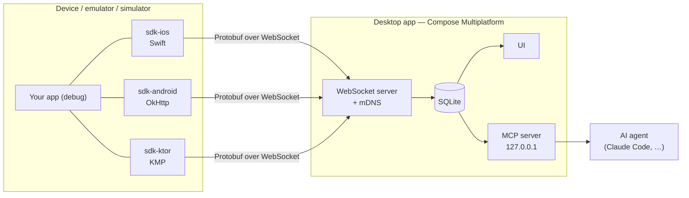

# App Monitor

**See every request your mobile app makes — live, on your desktop, without a
proxy.**

App Monitor is a network monitor and debug toolkit for **iOS**, **Android** and
**Kotlin Multiplatform** apps. A small SDK inside your debug build streams
traffic to a **Compose Multiplatform desktop app** (macOS, Linux, Windows) on
the same network. The desktop keeps a searchable history and exposes a local
**MCP server**, so AI agents like Claude can answer questions such as *"why did
checkout fail in the last run?"* straight from the captured traffic.

> [!NOTE]
> **Status: pre-alpha.** Code lands milestone by milestone. Android apps
> using OkHttp show their traffic in the desktop, on the emulator and on a
> device; iOS apps show all their `URLSession` traffic, proven on the
> simulator so far (DEBT-0041). Every PR to `main` passes a release gate:
> desktop tests on three OSes, the Kotlin ↔ Swift contract, both samples end
> to end, unsigned packages and an SDK publication dry-run. Everything below
> marked *planned* does not exist yet. Current milestone:
> [M3 — Release gate](docs/plans/0004-release-gate.md).

## Why

- **No proxy, no certificates.** Capture happens inside the app, so it works
  with VPNs, corporate networks and certificate pinning.
- **One desktop for every platform.** iOS, Android and KMP apps report to the
  same window, on whatever OS you develop on.
- **History you can query.** Named runs, saved issues, per-endpoint
  benchmarks and run-to-run diffs — for you and for your AI agent.
- **Debug builds only.** Release builds link no-op artifacts with the same API.

App Monitor is the successor of
[app-network-monitor](https://github.com/christianalexandre/app-network-monitor),
an iOS-only tool built to replace netfox in a large retail app.

## How it works



1. The desktop app starts a server and announces itself on the local network
   (mDNS, `_appmonitor._tcp`).
2. The SDK finds it automatically: mDNS on physical devices, `10.0.2.2` on the
   Android emulator, `127.0.0.1` on the iOS simulator.
3. Every request, response, error and WebSocket frame is sent as a Protobuf
   message inside a channel envelope — the same transport will carry logs,
   analytics and storage inspection later.


Design details: [architecture](docs/sdd/01_architecture.md) and the
[decision records](docs/adr/README.md).

## Platforms

| Platform | SDK | Captures | Status |
| --- | --- | --- | --- |
| Android | `sdk/android-okhttp` + `sdk/core` | OkHttp calls and WebSockets (Retrofit, Apollo, …) | works, unpublished — M1 |
| iOS | `sdk/ios` (Swift Package, iOS 15) | All `URLSession` traffic and WebSocket tasks, incl. background sessions | works on the simulator, unpublished — M2 |
| iOS | `sdk/ios` | gRPC and third-party sockets (metadata in-app, full content via desktop proxy) | planned — M8 |
| KMP | `sdk-ktor` | Ktor `HttpClient`, all targets | planned — M4 |
| Desktop | macOS · Linux · Windows | — | in-memory, device approval — M1 |

## Roadmap

| Milestone | Delivers |
| --- | --- |
| [M0 — Foundation](docs/plans/0001-foundation.md) | Protocol, desktop server and UI, fake traffic end to end |
| [M1 — Android SDK](docs/plans/0002-android-sdk.md) | Real Android apps on emulator and device |
| [M2 — iOS SDK](docs/plans/0003-ios-sdk.md) | Real iOS apps, full `URLSession` coverage |
| [M3 — Release gate](docs/plans/0004-release-gate.md) | CI proving desktop ×3 OS, contracts, Android and iOS e2e before every release |
| M4 — KMP SDK | Ktor plugin for every KMP target |
| M5 — Persistence | Runs, search, filters, retention |
| M6 — MCP server | Traffic, runs and stats queryable by AI agents |
| M7 — Insights | Issues, p50/p95/p99 per endpoint, run diffs, HAR and cURL export |
| M8 — iOS deep capture | gRPC adapters, connection metadata, desktop MITM proxy mode |
| M9 — Interaction | Mocks, breakpoints, replay |
| M10 — Distribution | Unsigned packages, Homebrew tap, Maven Central, SwiftPM |

Scope per milestone: [roadmap](docs/plans/README.md#roadmap).

## Usage

> [!IMPORTANT]
> Not published yet (M10); the API may change before then. The Android API
> is in [ADR-0017](docs/adr/0017-android-sdk-public-api.md), the iOS one in
> [ADR-0035](docs/adr/0035-ios-sdk-public-api.md).

```kotlin
// Android — Application.onCreate
AppMonitor.start(this, AppMonitorOptions(appName = "My App"))

val client = OkHttpClient.Builder()
    .addInterceptor(AppMonitorInterceptor())
    .build()
val webSockets = AppMonitorWebSocketFactory(client) // optional, captures frames
```

Debug builds depend on `sdk/android-okhttp`, release builds on
`sdk/okhttp-no-op` (same API, does nothing). A working app is in
[`samples/android`](samples/android).

```swift
// iOS — App.init or application(_:didFinishLaunchingWithOptions:)
import AppMonitor

AppMonitor.start(AppMonitorOptions(appName: "My App"))
```

Every `URLSession` is captured without further code, except a request
carrying `X-AppMonitor-Capture`: `sdk/ktor` sets it on what it already
captured ([ADR-0064](docs/adr/0064-ktor-swift-dedupe-by-correlation-header.md)). The same `AppMonitor`
product compiles to stubs in configurations whose name lacks `Debug`, and
the Run Script phase `sdk/ios/scripts/add_local_network_keys.sh` adds the
local network keys to debug builds only. A working app is in
[`samples/ios`](samples/ios).

## How this project is built

App Monitor is developed by one person with an AI agent (Claude Code) working
in a documented loop. The process is part of the portfolio:

- **[`AGENTS.md`](AGENTS.md)** — the rules any agent follows: what it may
  decide alone, when it must stop and ask, how it reports.
- **[Plans](docs/plans/README.md)** — one numbered plan per milestone. Every
  task has an acceptance command; finished plans stay in the repo with their
  outcome, as history.
- **[Decision records](docs/adr/README.md)** — why the design is what it is.
- **[Tech debt](docs/tech-debt/README.md)** — known gaps, each with the event
  that forces it to be paid.
- **Fresh-context loop** — `make loop` runs one task per session; the docs are
  the only memory, so they stay current.
- **Conventions enforced by CI** — semantic branches, Conventional Commits,
  one PR template per change type, protected `dev` and `main`.
- **Release gate** — `main` requires
  [`release-gate.yml`](.github/workflows/release-gate.yml) green: desktop
  ×3 OS, contract tests, Android and iOS end to end, packages, SDK dry-run.

## Contributing

The project is not open to contributions yet. To work on it locally:

```sh
make help     # list commands
make check    # run all gates
```

Toolchain: [development environment](docs/sdd/02_development_environment.md).
Workflow: [git and pull requests](docs/guidelines/03_git_and_pull_requests.md).

## License

[MIT](LICENSE).
