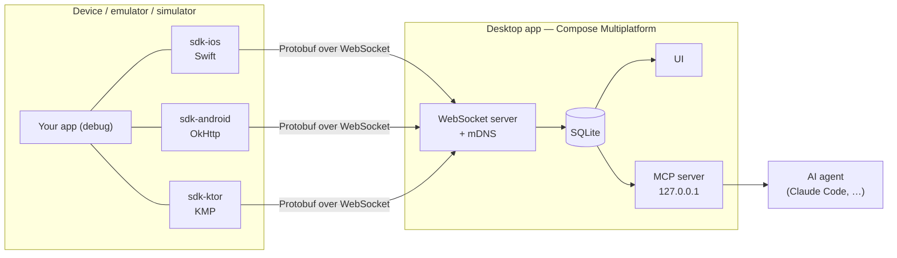
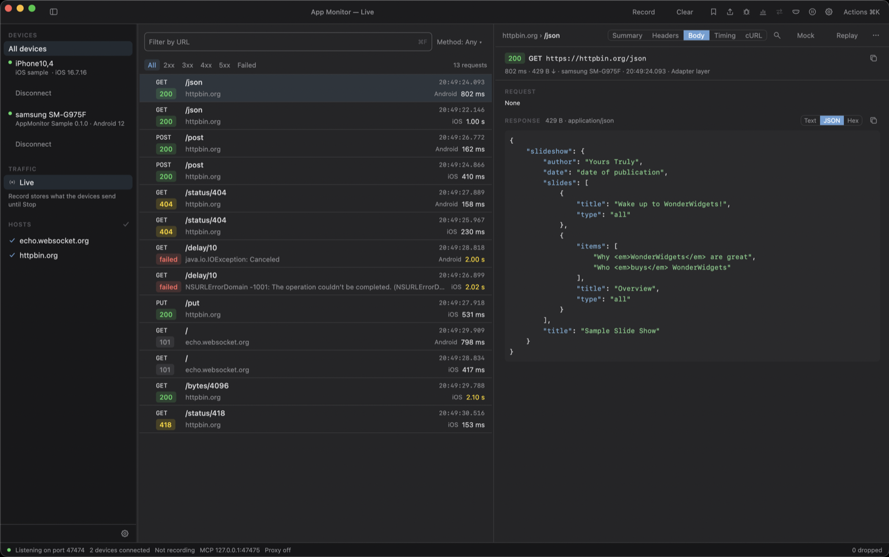

# App Monitor

[](https://central.sonatype.com/namespace/io.github.christianalexandre)
[](https://github.com/christianalexandre/app-monitor/releases)
[](docs/guide/compatibility.md)
[](LICENSE)

**See every request your mobile app makes — live, on your desktop, without a
proxy.**

App Monitor is a network monitor and debug toolkit for **Android**, **iOS** and
**Kotlin Multiplatform** apps. A small SDK inside your debug build streams
traffic to a desktop app (macOS, Linux, Windows) on the same network. The
desktop keeps a searchable history, lets you mock, hold and replay requests,
and answers your AI agent's questions about the traffic over a local MCP
server.

> [!IMPORTANT]
> **For debug builds only.** App Monitor captures every request and response,
> bodies included, and sends them over your local network. Release builds
> never carry it: on Android the Gradle plugin gives them no-op artifacts and
> fails a release build that would still hold the SDK; on iOS the Run Script
> fails an optimized build that links it.

## Why

- **No proxy, no certificates.** Capture happens inside the app, so it works
  with VPNs, corporate networks and certificate pinning.
- **One desktop for every platform.** Android, iOS and KMP apps report to the
  same window, on whatever OS you develop on.
- **History you can query.** Named runs, saved issues, per-endpoint
  benchmarks and run-to-run diffs — for you and for your AI agent.
- **Mocks, breakpoints and replay.** Answer a request from the desktop, hold
  it to edit it, or send it again.

## How it works



1. The desktop app starts a server and announces itself on the local network
   (mDNS, `_appmonitor._tcp`).
2. The SDK finds it automatically: mDNS on physical devices, `10.0.2.2` on the
   Android emulator, `127.0.0.1` on the iOS simulator.
3. Every request, response, error and WebSocket frame is sent as a Protobuf
   message inside a channel envelope — the same transport will carry logs,
   analytics and storage inspection later.



## Getting started

### 1. Install the desktop app

From `1.0.0`, on macOS (Apple silicon):

```sh
brew install --cask christianalexandre/tap/app-monitor
```

On Windows:

```powershell
scoop bucket add christianalexandre https://github.com/christianalexandre/homebrew-tap
scoop install christianalexandre/app-monitor
```

On Linux, the `.deb` or `.rpm` of the
[latest release](https://github.com/christianalexandre/app-monitor/releases/latest). The
packages are not signed, so the first launch asks once; the
[desktop guide](docs/guide/desktop.md) says how, and how to run it from the repository
instead.

### 2. Add the SDK to your app

#### Android

Apply the plugin in the app module. It adds the SDK to debug builds and
captures every `OkHttpClient` (Retrofit, Apollo, Ktor's OkHttp engine…):

```kotlin
// app/build.gradle.kts
plugins {
    id("io.github.christianalexandre.appmonitor") version "1.0.0"
}
```

Start it in `Application.onCreate`:

```kotlin
import appmonitor.sdk.core.AppMonitor
import appmonitor.sdk.core.AppMonitorOptions

AppMonitor.start(this, AppMonitorOptions(appName = "My App"))
```

The plugin is on Maven Central: `pluginManagement` in `settings.gradle.kts`
must list `mavenCentral()`. New Android Studio projects already do. Details
and options are in the [Android guide](docs/guide/android.md).

#### iOS

1. **Add the package.** *File → Add Package Dependencies…*,
   `https://github.com/christianalexandre/app-monitor`, *Up to Next Major
   Version* from `1.0.0`, product `AppMonitor`, to the app target.
2. **Start it** in `App.init` or `application(_:didFinishLaunchingWithOptions:)`:

   ```swift
   #if DEBUG
   import AppMonitor
   #endif

   #if DEBUG
   AppMonitor.start(AppMonitorOptions(appName: "My App"))
   #endif
   ```

3. **Exclude it from release builds.** In the target's *Build Settings*, for
   every configuration that ships (`Release`, …):
   `EXCLUDED_SOURCE_FILE_NAMES = AppMonitor*`.
4. **Paste the Run Script** from the [iOS guide](docs/guide/ios.md#4-paste-the-run-script)
   as the target's last build phase. It adds the keys a physical iPhone needs
   and fails a build that would ship the SDK.

Every `URLSession` is captured, with no further code. gRPC Swift 2 and
troubleshooting are in the [iOS guide](docs/guide/ios.md).

#### Kotlin Multiplatform

Follow the Android steps and the iOS steps, nothing more: they capture Ktor's
OkHttp engine on Android and its Darwin engine on iOS. With another engine
(CIO, Java…), see the [KMP guide](docs/guide/kmp.md).

### 3. Run your debug build

Open the app and accept it in the desktop the first time it connects; the
answer is remembered. Its traffic then streams in. The emulator and the
simulator need nothing else.

> [!TIP]
> **On a physical device**, the phone and the computer must be on the same
> Wi-Fi. Android 17+ and iOS ask once for local network access: allow it.
> From then on, the device keeps to that desktop. The rest is in
> [Physical devices](docs/guide/desktop.md#physical-devices).

## Ask your AI agent

The desktop serves its history over MCP on `127.0.0.1`. With Claude Code, open
the desktop's settings, *MCP server*, click *Copy command* and paste it in a
terminal. Then ask, for example, *"why did checkout fail in the last run?"*.
Other clients and the list of tools are in the [MCP guide](docs/guide/mcp.md).

## Documentation

- [Guides](docs/guide/README.md): Android, iOS, KMP, the desktop, MCP, and
  [compatibility](docs/guide/compatibility.md).
- [Changelog](CHANGELOG.md).
- [How this project is built](docs/README.md): one person and an AI agent in
  a documented loop, with its decisions, plans and release gate.

App Monitor is the successor of
[app-network-monitor](https://github.com/christianalexandre/app-network-monitor),
an iOS-only tool built to replace netfox in a large retail app.

## License

[MIT](LICENSE).
