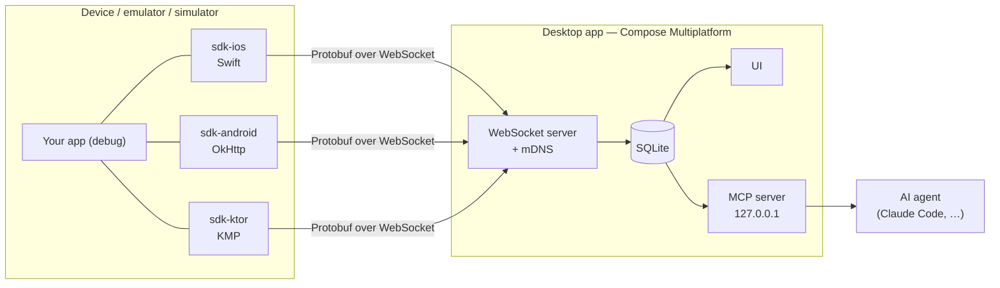
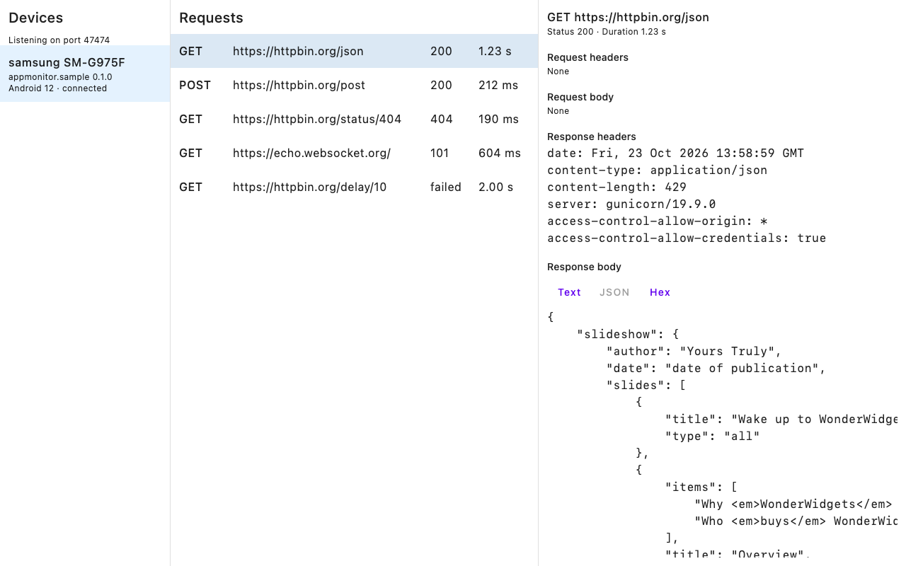

# App Monitor

**See every request your mobile app makes — live, on your desktop, without a
proxy.**

App Monitor is a network monitor and debug toolkit for **iOS**, **Android** and
**Kotlin Multiplatform** apps. A small SDK inside your debug build streams
traffic to a **Compose Multiplatform desktop app** (macOS, Linux, Windows) on
the same network. The desktop keeps a searchable history and exposes a local
**MCP server**, so AI agents like Claude can answer questions such as *"why did
checkout fail in the last run?"* straight from the captured traffic.

> [!NOTE]
> **Status: pre-alpha.** Code lands milestone by milestone. Android apps
> using OkHttp show their traffic in the desktop, on the emulator and on a
> device; iOS apps show all their `URLSession` traffic, proven on the
> simulator so far (DEBT-0041); Kotlin Multiplatform apps show their Ktor
> traffic from Android and iOS, and an iOS app running both SDKs shows each
> exchange once. Every PR to `main` passes a release gate: desktop tests on
> three OSes, the Kotlin ↔ Swift contract, every sample app, the Android, iOS
> and KMP samples end to end, unsigned packages and an SDK publication
> dry-run. The desktop keeps what it captured across restarts, grouped in
> named runs, searchable and bounded by retention settings, and serves that
> history to AI agents over a local MCP server. Everything below marked
> *planned* does not exist yet. Current milestone:
> [M8 — iOS deep capture](docs/plans/0009-ios-deep-capture.md).

## Why

- **No proxy, no certificates.** Capture happens inside the app, so it works
  with VPNs, corporate networks and certificate pinning.
- **One desktop for every platform.** iOS, Android and KMP apps report to the
  same window, on whatever OS you develop on.
- **History you can query.** Named runs, saved issues, per-endpoint
  benchmarks and run-to-run diffs — for you and for your AI agent.
- **Debug builds only.** Release builds link no-op artifacts with the same API.

App Monitor is the successor of
[app-network-monitor](https://github.com/christianalexandre/app-network-monitor),
an iOS-only tool built to replace netfox in a large retail app.

## How it works



1. The desktop app starts a server and announces itself on the local network
   (mDNS, `_appmonitor._tcp`).
2. The SDK finds it automatically: mDNS on physical devices, `10.0.2.2` on the
   Android emulator, `127.0.0.1` on the iOS simulator.
3. Every request, response, error and WebSocket frame is sent as a Protobuf
   message inside a channel envelope — the same transport will carry logs,
   analytics and storage inspection later.



Design details: [architecture](docs/sdd/01_architecture.md) and the
[decision records](docs/adr/README.md).

## Platforms

| Platform | SDK | Captures | Status |
| --- | --- | --- | --- |
| Android | `sdk/android-okhttp` + `sdk/core` | OkHttp calls and WebSockets (Retrofit, Apollo, …) | works, unpublished — M1 |
| iOS | `sdk/ios` (Swift Package, iOS 15) | All `URLSession` traffic and WebSocket tasks, incl. background sessions | works on the simulator, unpublished — M2 |
| iOS | `sdk/ios` product `AppMonitorGRPC` (iOS 18) | gRPC Swift 2 calls in full, one interceptor | works in host tests, unpublished — M8 |
| iOS | `sdk/ios` | Third-party sockets (metadata in-app, full content via desktop proxy) | planned — M8 |
| KMP | `sdk/ktor` + `sdk/core` (Android, `iosArm64`, `iosSimulatorArm64`; Ktor 3.6+) | Ktor `HttpClient` calls and WebSocket frames | works on the emulator and the simulator, unpublished — M4 |
| Desktop | macOS · Linux · Windows | — | SQLite history in named runs, search, retention, remembered approvals, MCP server on `127.0.0.1` — M1, M5, M6 |

## Roadmap

| Milestone | Delivers |
| --- | --- |
| [M0 — Foundation](docs/plans/0001-foundation.md) | Protocol, desktop server and UI, fake traffic end to end |
| [M1 — Android SDK](docs/plans/0002-android-sdk.md) | Real Android apps on emulator and device |
| [M2 — iOS SDK](docs/plans/0003-ios-sdk.md) | Real iOS apps, full `URLSession` coverage |
| [M3 — Release gate](docs/plans/0004-release-gate.md) | CI proving desktop ×3 OS, contracts, Android and iOS e2e before every release |
| [M4 — KMP SDK](docs/plans/0005-kmp-sdk.md) | Ktor plugin on Android and iOS, deduped with the Swift SDK |
| [M5 — Persistence](docs/plans/0006-persistence-and-runs.md) | Runs, search, filters, retention |
| [M6 — MCP server](docs/plans/0007-mcp-server.md) | Traffic, runs and stats queryable by AI agents |
| [M7 — Insights](docs/plans/0008-issues-benchmarks-export.md) | Issues, p50/p95/p99 per endpoint, run diffs, HAR and cURL export |
| [M8 — iOS deep capture](docs/plans/0009-ios-deep-capture.md) | gRPC adapters, connection metadata, desktop MITM proxy mode |
| [M9 — Interaction](docs/plans/0010-interaction.md) | Mocks, breakpoints, replay, OkHttp injection by the Gradle plugin |
| M10 — Distribution | Unsigned packages, Homebrew tap, Maven Central, SwiftPM |

Scope per milestone: [roadmap](docs/plans/README.md#roadmap).

## Installation

> [!IMPORTANT]
> Not published yet (M10); the API may change before then. The Android API
> is in [ADR-0017](docs/adr/0017-android-sdk-public-api.md), the iOS one in
> [ADR-0035](docs/adr/0035-ios-sdk-public-api.md), the KMP one in
> [ADR-0062](docs/adr/0062-kmp-sdk-public-api.md).

### Android

Two steps. Release builds get the no-op artifacts, and a release that still
resolves the real SDK fails to build
([ADR-0157](docs/adr/0157-the-gradle-plugin-adds-the-sdk-and-fails-a-release-that-keeps-it.md)).

1. **Apply the plugin** in the app module. It adds the SDK to debuggable
   variants and the no-ops to the others, and adds the OkHttp interceptor
   to every `OkHttpClient` of a debug build, library clients (Retrofit,
   Apollo, Ktor's OkHttp engine) included:

   ```kotlin
   // app/build.gradle.kts
   plugins {
       id("io.github.christianalexandre.appmonitor") version "<version>"
   }
   ```

2. **Start it** in `Application.onCreate`:

   ```kotlin
   AppMonitor.start(this, AppMonitorOptions(appName = "My App"))
   ```

Nothing else. On Android 17 the SDK asks for `ACCESS_LOCAL_NETWORK` itself,
once, on the first screen; it reaches the desktop's `ws://` whatever the
app's network security config says
([ADR-0156](docs/adr/0156-android-sdk-asks-for-its-permission-and-ignores-the-cleartext-policy.md)).
WebSocket frames are captured the same way, from `OkHttpClient.newWebSocket`
([ADR-0159](docs/adr/0159-okhttp-websockets-captured-by-the-gradle-plugin.md)).
The SDK never brings OkHttp to an app or changes its version.
`appMonitor { injectOkHttp = false }` turns the rewrite off;
`AppMonitorInterceptor()` and `AppMonitorWebSocketFactory(client)` then add
it by hand ([SDD 05](docs/sdd/05_okhttp_capture.md)).
A working app is in [`samples/android`](samples/android).

### iOS

Four steps. Release builds hold none of the SDK's code: it is not
linked and has no stubs ([ADR-0155](docs/adr/0155-ios-sdk-left-out-of-release-builds-by-the-app.md)).

1. **Add the package.** *File → Add Package Dependencies…*,
   `https://github.com/christianalexandre/app-monitor`, product
   `AppMonitor`, to the app target.
2. **Start it under `#if DEBUG`**, in `App.init` or
   `application(_:didFinishLaunchingWithOptions:)`:

   ```swift
   #if DEBUG
   import AppMonitor
   #endif

   #if DEBUG
   AppMonitor.start(AppMonitorOptions(appName: "My App"))
   #endif
   ```

3. **Exclude it from every release configuration.** In the app target's
   *Build Settings*, *Excluded Source File Names* for `Release` (and
   `Prod`, `Staging`, … whatever ships):

   ```text
   EXCLUDED_SOURCE_FILE_NAMES = AppMonitor*
   ```

   In an `.xcconfig`, `EXCLUDED_SOURCE_FILE_NAMES[config=Release] = AppMonitor*`;
   in XcodeGen, under the target's `settings: configs: Release:`. A
   configuration's name does not matter. Only this setting does.
4. **Paste the Run Script.** A *New Run Script Phase* on the app target,
   last. It adds the local network keys a physical device needs, and
   **fails a build that would ship the SDK**: an optimized configuration
   without step 3. Nothing to fill in. The usage text can be changed with
   an `APPMONITOR_LOCAL_NETWORK_USAGE` build setting, and a configuration
   that must keep the SDK optimized sets `APPMONITOR_ALLOW_OPTIMIZED = YES`.

   ```sh appmonitor-run-script
   #!/bin/sh
   # AppMonitor Run Script (ADR-0155). A configuration whose EXCLUDED_SOURCE_FILE_NAMES
   # excludes AppMonitor.o is left as is; any other links the SDK: it fails when
   # optimized, else gets the local network keys. Keys the app already has are kept.
   set -eu

   plist="${TARGET_BUILD_DIR:?run from an Xcode Run Script build phase}/${INFOPLIST_PATH:?}"
   usage="${APPMONITOR_LOCAL_NETWORK_USAGE:-AppMonitor sends the network traffic of this debug build to the AppMonitor desktop app on your local network.}"
   service="_appmonitor._tcp"

   set -f
   for pattern in ${EXCLUDED_SOURCE_FILE_NAMES:-}; do
     case AppMonitor.o in
       $pattern)
         echo "AppMonitor: excluded from ${CONFIGURATION:-this build}, Info.plist left as is"
         exit 0
         ;;
     esac
   done
   set +f

   if [ "${SWIFT_OPTIMIZATION_LEVEL:--Onone}" != "-Onone" ] && [ "${APPMONITOR_ALLOW_OPTIMIZED:-NO}" != YES ]; then
     echo "error: AppMonitor is linked into the optimized ${CONFIGURATION:-build}." \
       "Set EXCLUDED_SOURCE_FILE_NAMES = AppMonitor* on it, or APPMONITOR_ALLOW_OPTIMIZED = YES to keep the SDK."
     exit 1
   fi

   if ! plutil -extract NSLocalNetworkUsageDescription raw -o /dev/null "$plist" 2>/dev/null; then
     plutil -insert NSLocalNetworkUsageDescription -string "$usage" "$plist"
   fi
   if ! plutil -extract NSBonjourServices raw -o /dev/null "$plist" 2>/dev/null; then
     plutil -insert NSBonjourServices -array "$plist"
   fi
   if ! plutil -extract NSBonjourServices json -o - "$plist" | grep -q "\"$service\""; then
     plutil -insert NSBonjourServices -string "$service" -append "$plist"
   fi
   echo "AppMonitor: local network keys in $plist"
   ```

   Under `ENABLE_USER_SCRIPT_SANDBOXING` (on in new Xcode projects) the
   phase needs these, or the sandbox denies the write:

   ```text
   Input files:   $(TARGET_BUILD_DIR)/$(INFOPLIST_PATH)
   Output files:  $(TARGET_BUILD_DIR)/$(INFOPLIST_PATH)
                  $(DERIVED_FILE_DIR)/appmonitor-local-network-keys.stamp
   ```

   If the app already has a script phase that edits the built `Info.plist`
   (a build number, for one), Xcode may stop with `Multiple commands produce
   '…/Info.plist'`. With sandboxing off, drop the `Info.plist` from the
   output files and keep the stamp. With it on, the app's own phase has to
   declare the same output.

The simulator needs only steps 1 to 3: it reaches the desktop on
`127.0.0.1`. Every `URLSession` is captured without further code, except a
request carrying `X-AppMonitor-Capture`: `sdk/ktor` sets it on what it
already captured ([ADR-0064](docs/adr/0064-ktor-swift-dedupe-by-correlation-header.md)). A socket the app's
other code opens, a gRPC-Core SDK's for one, shows as a connection: host,
port, bytes and timing, no content; `captureConnections: false` in the
options turns that off ([SDD 07](docs/sdd/07_ios_urlsession_capture.md)). A working app is in
[`samples/ios`](samples/ios).

```swift
// iOS with gRPC Swift 2 — add the AppMonitorGRPC product too; AppMonitor* excludes it as well
#if DEBUG
import AppMonitorGRPC
let interceptors: [any ClientInterceptor] = [AppMonitorGRPCInterceptor()]
#else
let interceptors: [any ClientInterceptor] = []
#endif

let client = GRPCClient(transport: transport, interceptors: interceptors)
```

Each call shows as one exchange, messages as bytes
([ADR-0099](docs/adr/0099-grpc-swift-adapter.md)); gRPC Swift 1 is not
covered.

### Kotlin Multiplatform

The Android steps and the iOS steps, nothing more. Ktor's OkHttp engine on
Android is OkHttp, so the plugin captures its calls and WebSocket frames;
its Darwin engine on iOS runs on `URLSession`, which the Swift SDK
captures. Nothing to install in `commonMain`, nothing to start in `iosMain`
([ADR-0158](docs/adr/0158-a-kmp-app-on-ios-is-captured-by-the-swift-sdk-alone.md)).

With another engine (CIO, Java, …), apply the plugin in the module that
builds the `HttpClient` too, which adds `appmonitor-ktor`, and install it:

```kotlin
val client = HttpClient(CIO) {
    install(AppMonitorKtor)
}
```

A working app is in [`samples/kmp`](samples/kmp).

### Ask your AI agent (MCP)

The desktop app serves its history over MCP (Streamable HTTP) on
`http://127.0.0.1:47475/mcp`, as soon as it starts. The server can only be
reached from your own machine and needs a bearer token. Eight read-only
tools: `list_runs`, `search_requests`, `get_request`, `endpoint_stats`,
`diff_runs`, `export_har`, `to_curl`, `list_issues`; and `save_issue`,
which creates and edits issues, the same ones the window shows; and
`create_mock`, which makes a mock rule that reaches no device until you
confirm it in the window's *Mocks* panel ([SDD 10](docs/sdd/10_desktop_mcp.md)). Bodies and headers are what the app
sent: masked on the device unless the app turned masking off.

**Claude Code.** Open the desktop's settings, *MCP server*, click *Copy
command* and paste it into a terminal:

```sh
claude mcp add --transport http app-monitor http://127.0.0.1:47475/mcp \
  --header "Authorization: Bearer <token>"
```

To share the server with a project without committing the token, put it in
the project's `.mcp.json` and read the token from the environment
(`export APPMONITOR_MCP_TOKEN=<token>` before starting `claude`):

```json
{
  "mcpServers": {
    "app-monitor": {
      "type": "http",
      "url": "http://127.0.0.1:47475/mcp",
      "headers": { "Authorization": "Bearer ${APPMONITOR_MCP_TOKEN}" }
    }
  }
}
```

Then ask, for example, *"why did a request fail in the current run, and which
endpoints are new compared with run 1?"*.

**Any other Streamable HTTP client.** URL `http://127.0.0.1:47475/mcp`,
header `Authorization: Bearer <token>`. A client that sends an `Origin` must
send `http://127.0.0.1:47475` or `http://localhost:47475`; anything else gets
`403`, a missing or wrong token `401`.

**Check it by hand** with the [MCP Inspector](https://github.com/modelcontextprotocol/inspector)
(Node 22.19 or newer):

```sh
npx @modelcontextprotocol/inspector --cli http://127.0.0.1:47475/mcp \
  --header "Authorization: Bearer <token>" --method tools/list
npx @modelcontextprotocol/inspector --cli http://127.0.0.1:47475/mcp \
  --header "Authorization: Bearer <token>" --method tools/call --tool-name list_runs
```

**A client that only speaks stdio** can reach it through
[`mcp-remote`](https://github.com/geelen/mcp-remote) (not tested by this
project): `npx mcp-remote http://127.0.0.1:47475/mcp --header-file <file>`,
the file holding the `Authorization: Bearer <token>` line.

*Regenerate token* in the settings, or *Clear all data*, replaces the token:
paste the command again. The switch in the same section turns the server
off; `APPMONITOR_MCP_PORT=<n>` moves it to another port.

## How this project is built

App Monitor is developed by one person with an AI agent (Claude Code) working
in a documented loop. The process is part of the portfolio:

- **[`AGENTS.md`](AGENTS.md)** — the rules any agent follows: what it may
  decide alone, when it must stop and ask, how it reports.
- **[Plans](docs/plans/README.md)** — one numbered plan per milestone. Every
  task has an acceptance command; finished plans stay in the repo with their
  outcome, as history.
- **[Decision records](docs/adr/README.md)** — why the design is what it is.
- **[Tech debt](docs/tech-debt/README.md)** — known gaps, each with the event
  that forces it to be paid.
- **Fresh-context loop** — `make loop` runs one task per session; the docs are
  the only memory, so they stay current.
- **Conventions enforced by CI** — semantic branches, Conventional Commits,
  one PR template per change type, protected `dev` and `main`.
- **Release gate** — `main` requires
  [`release-gate.yml`](.github/workflows/release-gate.yml) green: desktop
  ×3 OS, contract tests, every sample app, Android, iOS and KMP end to end,
  packages, SDK dry-run.

## Contributing

The project is not open to contributions yet. To work on it locally:

```sh
make help        # list commands
make check       # fast suite, what PRs to dev run
make check-full  # plus simulator tests and every sample app
```

Toolchain: [development environment](docs/sdd/02_development_environment.md).
Workflow: [git and pull requests](docs/guidelines/03_git_and_pull_requests.md).

## License

[MIT](LICENSE).
