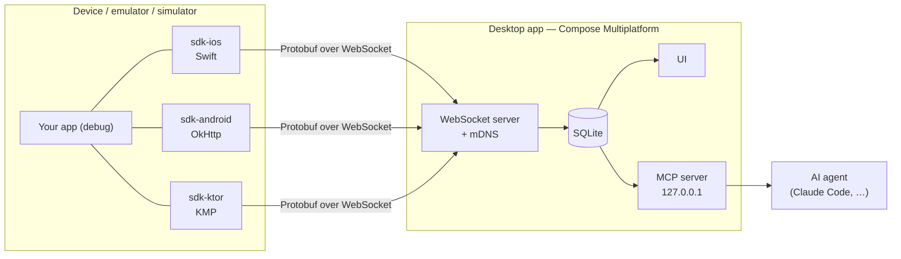

# App Monitor

**See every request your mobile app makes — live, on your desktop, without a
proxy.**

App Monitor is a network monitor and debug toolkit for **iOS**, **Android** and
**Kotlin Multiplatform** apps. A small SDK inside your debug build streams
traffic to a **Compose Multiplatform desktop app** (macOS, Linux, Windows) on
the same network. The desktop keeps a searchable history and exposes a local
**MCP server**, so AI agents like Claude can answer questions such as *"why did
checkout fail in the last run?"* straight from the captured traffic.

> [!NOTE]
> **Status: pre-alpha.** The architecture and workflow are defined; code lands
> milestone by milestone. Everything below marked *planned* does not exist
> yet. Current milestone: [M0 — Foundation](docs/plans/0001-foundation.md).

## Why

- **No proxy, no certificates.** Capture happens inside the app, so it works
  with VPNs, corporate networks and certificate pinning.
- **One desktop for every platform.** iOS, Android and KMP apps report to the
  same window, on whatever OS you develop on.
- **History you can query.** Named runs, saved issues, per-endpoint
  benchmarks and run-to-run diffs — for you and for your AI agent.
- **Debug builds only.** Release builds link no-op artifacts with the same API.

App Monitor is the successor of
[app-network-monitor](https://github.com/christianalexandre/app-network-monitor),
an iOS-only tool built to replace netfox in a large retail app.

## How it works



1. The desktop app starts a server and announces itself on the local network
   (mDNS, `_appmonitor._tcp`).
2. The SDK finds it automatically: mDNS on physical devices, `10.0.2.2` on the
   Android emulator, `localhost` on the iOS simulator.
3. Every request, response, error and WebSocket frame is sent as a Protobuf
   message inside a channel envelope — the same transport will carry logs,
   analytics and storage inspection later.

Design details: [architecture](docs/sdd/01_architecture.md) and the
[decision records](docs/adr/README.md).

## Platforms

| Platform | SDK | Captures | Status |
| --- | --- | --- | --- |
| Android | `sdk-android` | OkHttp (Retrofit, Apollo, …) | planned — M1 |
| iOS | `sdk-ios` (Swift Package) | All `URLSession` traffic, incl. background sessions | planned — M2 |
| iOS | `sdk-ios` | gRPC and third-party sockets (metadata in-app, full content via desktop proxy) | planned — M8 |
| KMP | `sdk-ktor` | Ktor `HttpClient`, all targets | planned — M4 |
| Desktop | macOS · Linux · Windows | — | skeleton, in-memory — M0 |

## Roadmap

| Milestone | Delivers |
| --- | --- |
| [M0 — Foundation](docs/plans/0001-foundation.md) | Protocol, desktop server and UI, fake traffic end to end |
| M1 — Android SDK | Real Android apps on emulator and device |
| M2 — iOS SDK | Real iOS apps, full `URLSession` coverage |
| M3 — Release gate | CI proving desktop ×3 OS, contracts, Android and iOS e2e before every release |
| M4 — KMP SDK | Ktor plugin for every KMP target |
| M5 — Persistence | Runs, search, filters, retention |
| M6 — MCP server | Traffic, runs and stats queryable by AI agents |
| M7 — Insights | Issues, p50/p95/p99 per endpoint, run diffs, HAR and cURL export |
| M8 — iOS deep capture | gRPC adapters, connection metadata, desktop MITM proxy mode |
| M9 — Interaction | Mocks, breakpoints, replay |
| M10 — Distribution | Signed packages, Homebrew, Maven Central, SwiftPM |

Scope per milestone: [roadmap](docs/plans/README.md#roadmap).

## Planned usage

> [!IMPORTANT]
> Illustrative only — the public API is defined in M1 and M2 and may change.

```kotlin
// Android — debug builds only
val client = OkHttpClient.Builder()
    .addInterceptor(AppMonitorInterceptor())
    .build()
```

```swift
// iOS
#if DEBUG
AppMonitor.start()
#endif
```

## How this project is built

App Monitor is developed by one person with an AI agent (Claude Code) working
in a documented loop. The process is part of the portfolio:

- **[`AGENTS.md`](AGENTS.md)** — the rules any agent follows: what it may
  decide alone, when it must stop and ask, how it reports.
- **[Plans](docs/plans/README.md)** — one numbered plan per milestone. Every
  task has an acceptance command; finished plans stay in the repo with their
  outcome, as history.
- **[Decision records](docs/adr/README.md)** — why the design is what it is.
- **[Tech debt](docs/tech-debt/README.md)** — known gaps, each with the event
  that forces it to be paid.
- **Fresh-context loop** — `make loop` runs one task per session; the docs are
  the only memory, so they stay current.
- **Conventions enforced by CI** — semantic branches, Conventional Commits,
  one PR template per change type, protected `dev` and `main`.

## Contributing

The project is not open to contributions yet. To work on it locally:

```sh
make help     # list commands
make check    # run all gates
```

Toolchain: [development environment](docs/sdd/02_development_environment.md).
Workflow: [git and pull requests](docs/guidelines/03_git_and_pull_requests.md).
