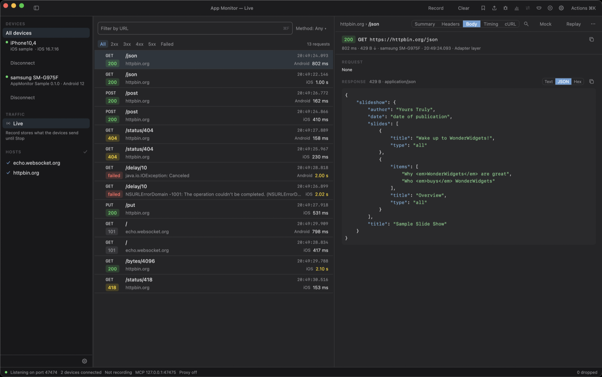
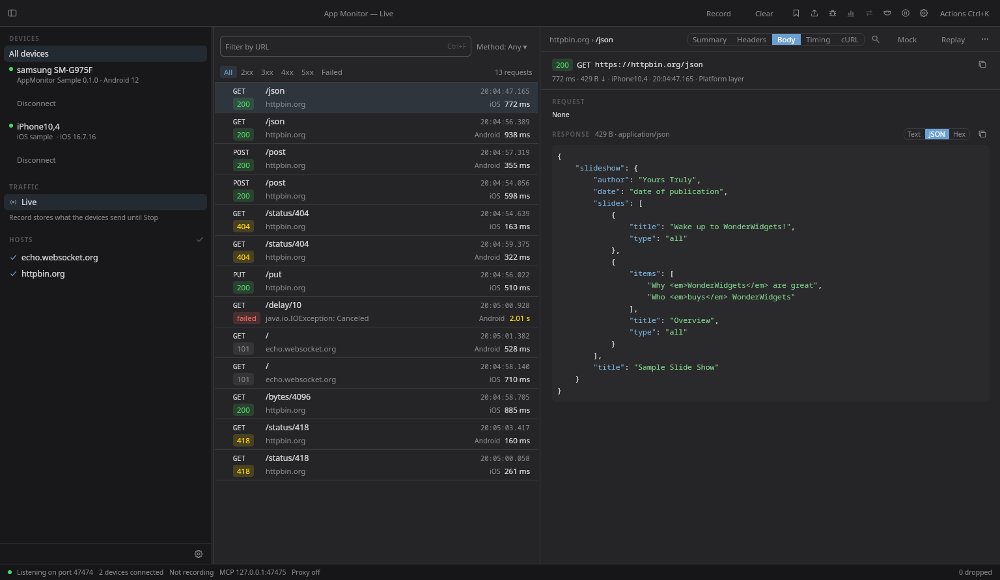
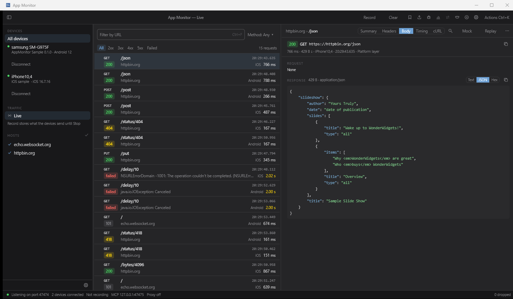

# Compatibility

## SDKs

| Platform | Install | Captures | Needs |
| --- | --- | --- | --- |
| Android | Gradle plugin `io.github.christianalexandre.appmonitor` | OkHttp calls and WebSockets, library clients included (Retrofit, Apollo, Ktor's OkHttp engine) | `minSdk` 24, Kotlin 2.2+; built against OkHttp 5.3 and tested with AGP 9.3 |
| iOS | Swift package, product `AppMonitor` | All `URLSession` traffic, background sessions and WebSocket tasks; other sockets as connections (no content) | iOS 15+; lowest tested: 16.0 on the simulator, 16.7 on a device ([ADR-0171](../adr/0171-the-ios-floor-the-sdk-declares.md)) |
| iOS | Swift package, product `AppMonitorGRPC` | gRPC Swift 2 calls, one interceptor | iOS 18+ |
| Kotlin Multiplatform | The Android and iOS steps; `appmonitor-ktor` for other engines | Ktor `HttpClient` calls and WebSocket frames | Ktor 3.6+; targets Android, `iosArm64`, `iosSimulatorArm64`; Kotlin 2.2+, or 2.4+ in a module reading `appmonitor-ktor`'s iOS klibs ([ADR-0218](../adr/0218-published-coordinates-consumers-and-the-ios-klib-floor.md)) |

Every SDK has the same version, published at the same tag
([changelog](../../CHANGELOG.md)). The desktop has its own (*Desktop X.Y.Z*
releases); a desktop and the SDKs work together when their major versions
match.

## Desktop

macOS on Apple silicon, Windows x64 and Linux x64 (`.deb` and `.rpm`), from Desktop
`1.1.0`'s packages, or from the repository with JDK 21 on any of them
([desktop guide](desktop.md)).

| macOS | Linux | Windows |
| --- | --- | --- |
|  |  |  |
